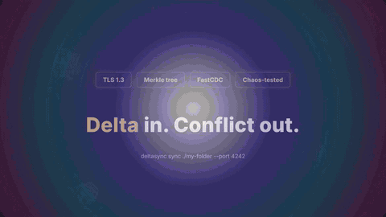

# DeltaSync

[](https://github.com/Sehaan-1/DeltaSync/actions/workflows/ci.yml)
[](https://sehaan-1.github.io/DeltaSync/)
[](LICENSE)

> Peer-to-Peer File Synchronization Engine with Delta Transfer, Conflict Detection, and Chaos-Tested Crash Safety.

🌐 **Live Showcase & Interactive Demo:** [https://sehaan-1.github.io/DeltaSync/](https://sehaan-1.github.io/DeltaSync/)



## Overview
DeltaSync is a cross-device synchronization engine designed to keep folders identical across machines with delta transfer, vector clock conflict resolution, and crash-safe reliability guarantees.

## Architecture
- `src/DeltaSync.Core`: Core domain models, Merkle tree prefix index, FastCDC chunking engines, vector clocks, and SQLite state repository.
- `src/DeltaSync.Network`: High-performance network transport layer with length-prefixed streaming TCP channels, optional TLS 1.3 encryption, BGP-4 collision tie-breaking, and hybrid UDP multicast / static peer discovery.
- `src/DeltaSync.Cli`: Command-line interface with Spectre.Console real-time status dashboard and Prometheus metrics scraper endpoint.
- `tests/DeltaSync.Tests`: Unit, property-based (FsCheck), and automated end-to-end integration test suites.

## Network Transport Layer
DeltaSync establishes direct peer-to-peer duplex connections across local area networks or static IP addresses:
- **Wire Framing Protocol:** Continuous TCP byte streams are converted into discrete message frames using a 4-byte big-endian unsigned integer length header ($1 \le L \le 4\text{ MB}$), strictly rejecting oversized payloads before buffer allocation.
- **Transport Security:** Full support for TLS 1.3 encryption (`SslStream`, ALPN `deltasync-v1`) with ephemeral certificate pinning.
- **Flow Control & Backpressure:** Inbound reader loops enforce bounded asynchronous channels ($C = 32$), capping pending memory at $\le 8\text{ MB}$ under pipelined chunk transfer.
- **BGP-4 Collision Teardown:** Simultaneous cross-dials resolve deterministically using total lexicographical ordering on canonical peer identifiers (RFC 4271 §6.8), cleanly aborting yielding sockets without RST spikes or resource leaks.

## Build and Run
```bash
# Build
dotnet build

# Run Tests
dotnet test

# Run CLI Sync Daemon
dotnet run --project src/DeltaSync.Cli -- sync ./my-folder --port 4242
```

